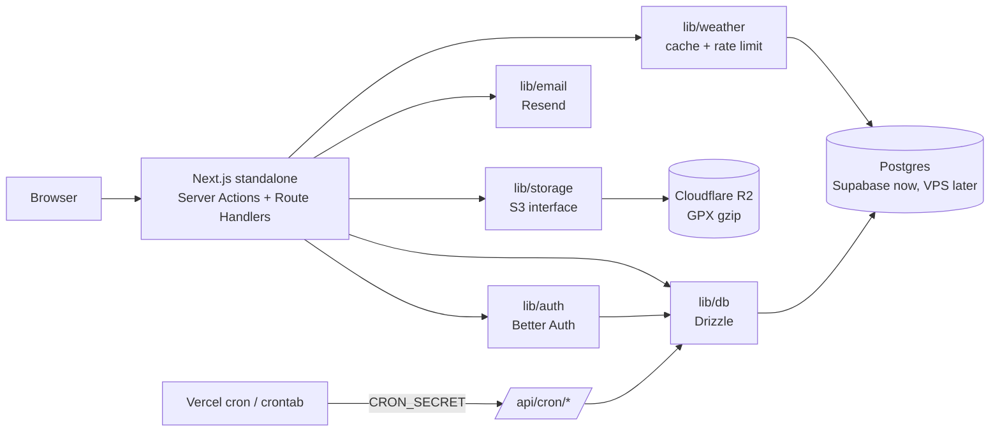

# PlanYourTrail.run — Arsitektur Tahap 1 (Free Registered)

Versi 1.1 · 26 Oktober 2026 · Mengacu ke PRD v2.6 (Section 9.5, 9.7, 9.8)

## 1. Keputusan

| Area | Keputusan |
|---|---|
| Framework | Next.js (App Router) + TypeScript, Node runtime, `output: "standalone"` hanya untuk build Docker |
| Backend | Server Actions untuk mutasi, Route Handlers untuk auth, cron, download GPX |
| Auth | Better Auth, di atas Postgres Supabase lewat `DATABASE_URL` (tanpa Supabase Auth) |
| ORM | Drizzle, migrasi SQL disimpan di repo |
| Database | Postgres (Supabase Free sekarang, VPS saat Pro launch) |
| Storage | Cloudflare R2 (Standard, free tier) di balik antarmuka S3 (`lib/storage`), mulai Tahap 1 dan tetap dipakai setelah migrasi VPS |
| Email | Resend, dikirim langsung dari aplikasi |
| Hosting | Vercel Hobby sampai Pro launch, lalu VPS (Docker) |
| Validasi | Zod di setiap boundary |
| Testing | Vitest + Playwright |

## 2. Asumsi

- "Tenant" = user. Satu rute dimiliki satu user. Belum ada model org/team karena PRD belum punya fitur kolaborasi.
- Belum ada akun existing (app sekarang tanpa auth), jadi tidak ada migrasi user.
- Fitur analisis (peta, elevation, segmen, weather) sudah live. Tahap 1 menambah gating dan fitur baru.
- GPX Anonymous diparse di client. Server memvalidasi ukuran saat menyimpan.

## 3. Diagram

## 4. Alur tenant context

1. Middleware hanya redirect optimistis (cek cookie). Bukan penjaga keamanan.
2. Server code memanggil `requireUser()`.
3. `can(user, feature)` memutuskan akses fitur (satu-satunya tempat keputusan).
4. Query Drizzle lewat helper yang selalu menyaring `user_id`. Tidak ada query rute tanpa filter pemilik.

## 5. Struktur App Router

- `app/(marketing)/` — landing
- `app/(app)/analyze` — terbuka untuk Anonymous
- `app/(app)/routes`, `app/(app)/account` — butuh login
- `app/api/auth/[...all]` — Better Auth
- `app/api/cron/*` — job terjadwal (dilindungi `CRON_SECRET`)
- `app/api/routes/[id]/gpx` — redirect ke signed URL
- `app/api/health` — health check (Docker, uptime)

Caching: halaman analisis dinamis. Weather di-cache di tabel Postgres dengan TTL. Tidak memakai ISR yang bergantung cache Vercel.

## 6. Modul

| Modul | Isi |
|---|---|
| `lib/db` | `client.ts`, `schema.ts`, `queries/*`; migrasi di `drizzle/` |
| `lib/auth` | `getSession()`, `requireUser()`, `signOut()` |
| `lib/storage` | `putObject`, `getObject`, `deleteObject`, `signedUrl` |
| `lib/entitlements` | `config.ts` (limit per tier), `can.ts` |
| `lib/email` | wrapper Resend + template Bahasa Indonesia |
| `lib/weather` | fetch, cache, rate limit |
| `lib/rate-limit` | limiter berbasis tabel Postgres |
| `lib/env.ts` | env tervalidasi Zod (lazy) |

## 7. Skema (garis besar)

- Tabel Better Auth (digenerate CLI-nya): user, session, account, verification
- `profile` (`user_id`, `plan` default `free`)
- `route` (`id`, `user_id`, `name`, `metrics` jsonb, `track_simplified`, `gpx_object_key`, `hidden`, `created_at`)
- `waitlist` (`user_id`, `feature`, `survey`, `created_at`)
- `weather_cache` (`key`, `payload`, `expires_at`)
- `rate_limit` (`key`, `window_start`, `count`)
- `daily_analytics` (sudah ada)

## 8. Wajib dicek

1. **RLS aktif di semua tabel tanpa policy.** Supabase mengekspos schema `public` lewat Data API dengan anon key. Server konek langsung sebagai role owner (bypass RLS), jadi app tetap jalan dan akses anon dari luar tertutup. Verifikasi di docs Supabase dan buat integration test.
2. **Pooler:** di Vercel pakai connection string pooler. Pada mode transaction, driver Postgres umumnya butuh prepared statements dimatikan.
3. **ID user:** default Better Auth berupa string. Cek opsi `generateId` bila ingin UUID.
4. **Pin versi Better Auth** dan jaga e2e test login di CI (ada laporan breaking change di patch version).
5. **Cron:** Vercel cron hanya pemicu. Logika ada di route biasa, dilindungi secret, supaya bisa dipanggil crontab di VPS.
